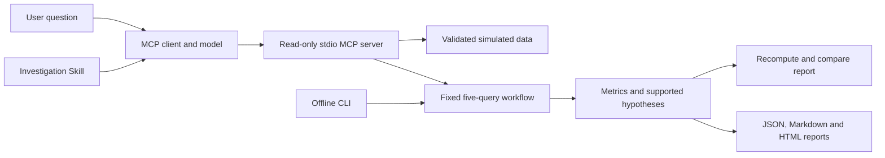

# Architecture and scope

This repository contains the business-specific extension, not the CraftAgents desktop application.

## Responsibilities

- `domain.ts`: Zod contracts, evidence/report types and complete date windows.
- `data.ts`: exact SKU lookup, uniqueness checks, missing dates, refresh status and evidence IDs.
- `core.ts`: deterministic metrics, hypotheses, action constraints and structured comparison.
- `runtime.ts`: a five-query baseline, tool-call budget, timeout, cancellation and ordered events.
- `mcp-server.ts`: nine fixed read-only tool contracts over stdio.
- `craft/skills/ecommerce-investigation/`: investigation SOP for compatible clients.
- `tests/`: fixed-case, failure-path and real stdio MCP integration checks.

## Model path and deterministic path

A model can query individual tools and explain the returned evidence. `investigate_sku` and the CLI use a fixed workflow without an LLM. A fixed report is a reproducible baseline, not autonomous model reasoning.

`review_report` recomputes the expected report from the dataset and compares structured fields. It reuses the same analysis implementation, so shared algorithm errors remain possible. Independent numerical test expectations complement the reviewer. It does not validate arbitrary prose or prove causality.

## Business boundaries

- All records are synthetic, fixed at 2026-10-12 in CNY.
- Missing records are not zeros; relevant metrics become null and reports can be partial.
- The fixture uses same-day paid-order attribution and one unit per order. Real platforms can have different attribution, refunds and order quantities.
- Gross margin excludes advertising costs. Candidate promotion prices are checked against product constraints; there is no complete current-price alerting system.
- Replenishment, price and advertising actions are unexecuted drafts. No business-write tool exists.
- The five-call budget and ten-second default timeout belong to the deterministic workflow, not to an outer model session. Stopping a wait does not guarantee cancellation of an uncooperative remote service.
- No real shop/ERP connector, scheduled monitor, case-memory retrieval, vector database or LLM judge is included.
